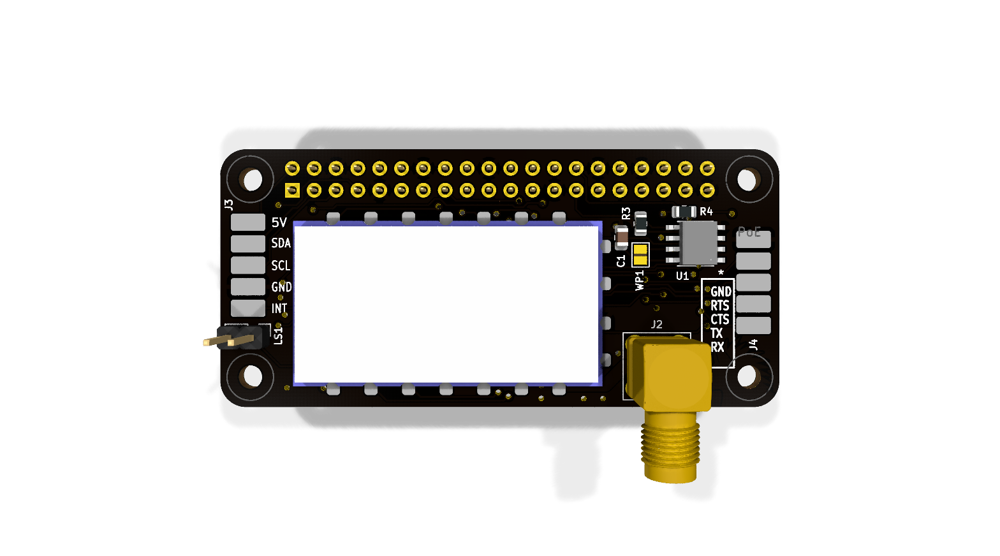
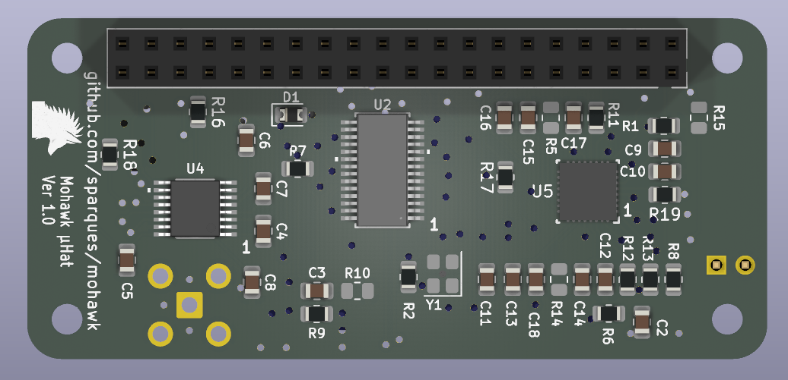

 

# Mohawk

Mohawk is a Raspberry Pi Zero µHAT-sized UHF/VHF radio interface built around a DRA818 radio module which comes in a UHF and a VHF variant (DRA818U / DRA818V). It brings the radio's audio, configuration UART, and push-to-talk control to a Raspberry Pi, and provides an RS-232 port for an external device. The current design is a KiCad 10 schematic and two-layer PCB. Hardware validation has not been recorded in this repository.

Linux has drivers for both the SPI UART interface and the codec, so two hardware TTYs show up and the codec shows up as a regular alsa soundcard. 

## Project files

| Path | Contents |
| --- | --- |
| [`mohawk/mohawk.kicad_pro`](mohawk/mohawk.kicad_pro) | KiCad project; open this file to work on the design. |
| [`mohawk/mohawk.kicad_sch`](mohawk/mohawk.kicad_sch) | Main schematic: Pi header, radio, UART bridge, RS-232, and HAT ID EEPROM. |
| [`mohawk/soundChip.kicad_sch`](mohawk/soundChip.kicad_sch) | Hierarchical sheet for the audio codec and speaker output. |
| [`mohawk/mohawk.kicad_pcb`](mohawk/mohawk.kicad_pcb) | Routed, approximately 65 × 30 mm, two-layer PCB. |
| [`mohawk/lib/`](mohawk/lib/) | Project-specific symbols, footprints, and 3D models. |
| [`datasheets/`](datasheets/) | Local copies of component datasheets. |

The schematic and board were saved with KiCad 10. Custom footprints use `${KIPRJMOD}/lib/KiCADv6/footprints.pretty`.

## Hardware overview

| Reference | Part | Role | Datasheet |
| --- | --- | --- | --- |
| U3 | DRA818 radio module (VHF variant intended) | RF transceiver; UART configuration, analog audio, PTT, squelch, and power-down signals | [DRA818V](datasheets/DRA818V.pdf) |
| U5 | TLV320AIC3204 | SPI-controlled audio codec with I²S/PCM audio to the Pi | [TLV320AIC3204](datasheets/tlv320aic3204.pdf) |
| U2 | SC16IS752 | SPI-to-dual-UART bridge: one channel for the radio, one for external serial | [SC16IS752](datasheets/SC16IS752_SC16IS762.pdf) |
| U4 | ‎MAX3232 | Converts the external UART channel to RS-232 levels | [‎MAX3232E](datasheets/‎MAX3232e.pdf) |
| U1 | CAT24C256 | Raspberry Pi HAT identification EEPROM on the dedicated ID I²C pins | — |
| Y1 | 1.8432 MHz oscillator | Clock for the SC16IS752 | [Abracon ASE series](datasheets/ASEseries.pdf) |

The BoM will be finalized once a verified working prototype has been assembled and specific part variants have been nailed down and confirmed good.

The Pi's SPI0 bus is shared by the UART bridge (CE1) and codec (CE0). The codec's digital audio uses the Pi's PCM/I²S pins. The bridge's two UART channels connect separately to the DRA818 and ‎MAX3232, leaving the Pi's built-in UART pins available on the 40-pin header. The codec connects to the radio's analog input and output; its `GPIO_MFP5` pin drives the radio's PTT net. The codec's right headphone output feeds the two-pin speaker connection through a coupling capacitor.

```text
                       SPI0 CE1 ── SC16IS752 ── UART A ── DRA818V ── SMA antenna
                      /                  └────── UART B ── ‎MAX3232 ── RS-232 pads
Raspberry Pi 40-pin ── SPI0 CE0 ── TLV320AIC3204 ── analog audio ── DRA818V
         header       └─ PCM/I²S ────────┘       └──────── speaker header
                      ID I²C ───── CAT24C256
                      I²C1 ─────── UI pads
```

## External connections

Pin numbers below come from the current schematic/netlist. Check the PCB pad numbering and your cable orientation before attaching hardware.

| Connector | Connection |
| --- | --- |
| J1 | 2 × 20 Raspberry Pi GPIO socket; supplies 5 V and 3.3 V and carries SPI0, PCM/I²S, I²C, and control GPIOs. |
| J2 | SMA antenna connector wired to the DRA818 `ANT` pin. |
| J3 | Five SMD pads for a UI board: 1 `GPIO17`, 2 GND, 3 `GPIO3/SCL1`, 4 `GPIO2/SDA1`, 5 +5 V. |
| J4 | Five SMD pads labeled “DB9 Header”: 1 `RS232_RX`, 2 `RS232_TX`, 3 `RS232_CTS`, 4 `RS232_RTS`, 5 GND. An external cable/connector is needed for a DB9 interface. |
| LS1 | Two-pin speaker header: codec headphone output via C18 and GND. |
| WP1 | Open solder jumper for EEPROM write protection; closing it connects the EEPROM's `WP` pin to 3.3 V. |

J3 carries **5 V power** but uses the Pi's **3.3 V GPIO/I²C signals**. `GPIO17` Is brought out for use as an interrupt, but is just a GPIO pin, so it could be used for an idicator LED or a button, etc. Use the netlist/pin table above when wiring a UI board.

There is no USB UART or 2 × 5 IDC RS-232 connector in the current schematic. The external serial connection is the ‎MAX3232 and J4's five SMD pads.

The HAT ID EEPROM uses `ID_SDA`/`ID_SCL` on J1 pins 27/28. Those are separate from the ordinary I²C1 pins used at J3. The device tree overlay is still a WIP, pending the first prototype build.

## Control signals on the Pi header

| Pi GPIO (physical pin) | Connected function |
| --- | --- |
| GPIO5 (29) | SC16IS752 reset |
| GPIO7 / SPI0 CE1 (26) | SC16IS752 chip select |
| GPIO8 / SPI0 CE0 (24) | TLV320AIC3204 chip select |
| GPIO18–21 (12, 35, 38, 40) | Codec bit clock, word clock, data to Pi, and data from Pi |
| GPIO22 (15) | DRA818 power-down (`PD`) |
| GPIO23 (16) | DRA818 squelch (`SQ`) |
| GPIO25 (22) | SC16IS752 interrupt |
| GPIO27 (13) | Codec reset |

The radio's `PTT` is connected to the codec's multifunction GPIO rather than directly to a Pi GPIO. Software must configure that codec pin before attempting to transmit. These are schematic connections, not a tested Linux setup or a promise of a particular `/dev/tty*` assignment.

## Design and build status

The PCB is routed in the saved design, and KiCad reports no unconnected items. A KiCad 10 check of this checkout found **26 ERC violations, 59 PCB DRC violations, and two schematic/PCB footprint-name parity warnings**. The DRC findings include silk overlap, copper-to-edge and hole-clearance errors, alongside warnings about copper islands, dangling copper, footprint library matches, and text thickness. Review and resolve the reports in KiCad before ordering boards. The schematic also marks R5, R10, R14, and R15 as do-not-populate.

To rerun the checks and export a BOM from the project root:

```sh
kicad-cli sch erc -o /tmp/mohawk-erc.rpt mohawk/mohawk.kicad_sch
kicad-cli pcb drc --schematic-parity -o /tmp/mohawk-drc.rpt mohawk/mohawk.kicad_pcb
kicad-cli sch export bom -o /tmp/mohawk-bom.csv mohawk/mohawk.kicad_sch
```

## Build Notes

U1 (the I²C EEPROM) and U4 (MAX3232) are technically optional. You do not need the MAX32322 or its supporting passives if you do not need RS-232 support. The I2C EEPROM lets a DeviceTree overlay be automatically loaded at boot so linux kernel modules know what the pin assignments are, but this is just a convenience and also not strictly required.

## Legal Notice

Neither this device nor the DRA818 module is, obviously, certified by the FCC. Only a suitably licensed individual may transmit using this device: you must have an amateur radio license. It is up to the operator to ensure they are following FCC requirements.